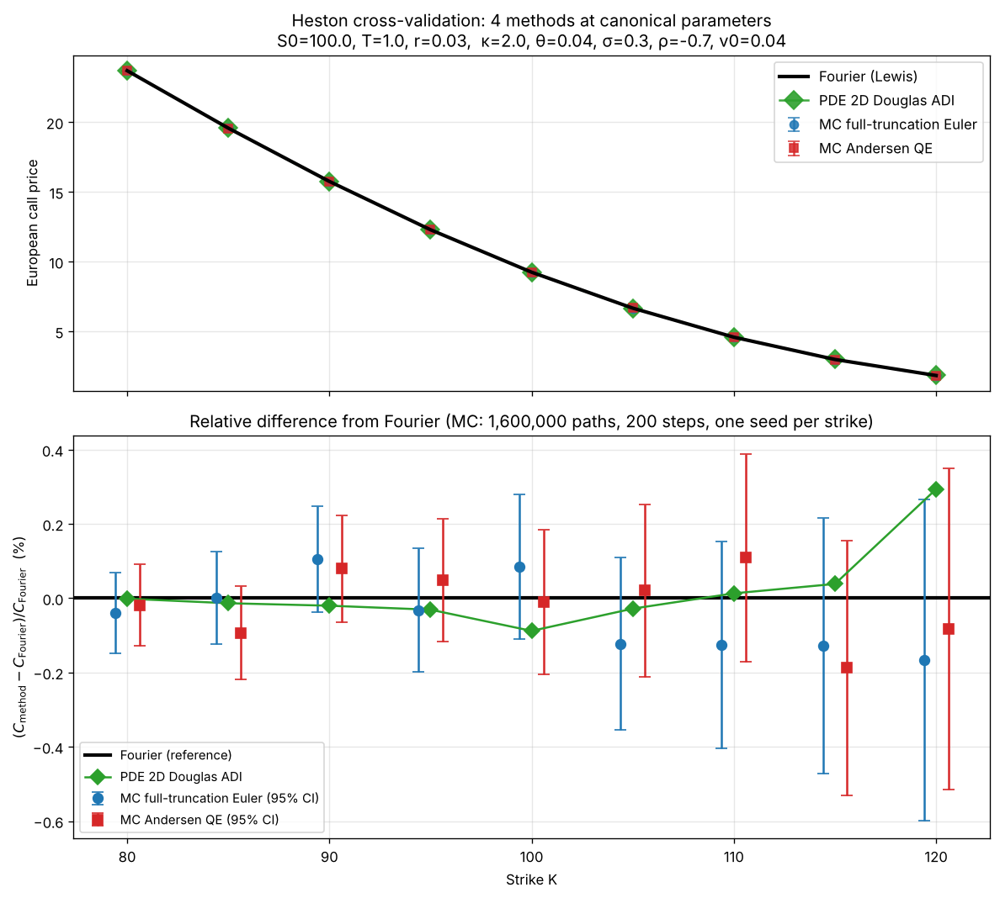
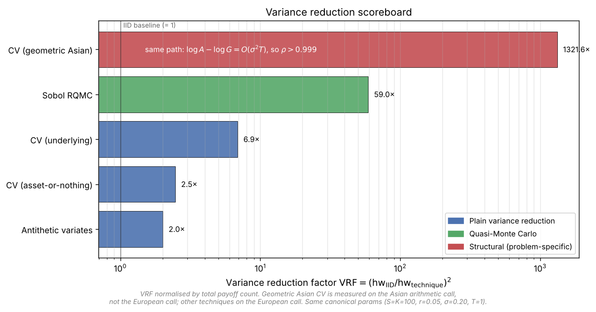
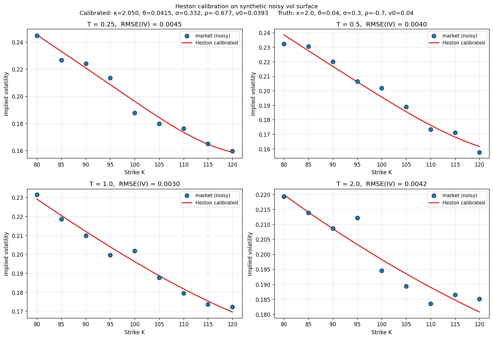
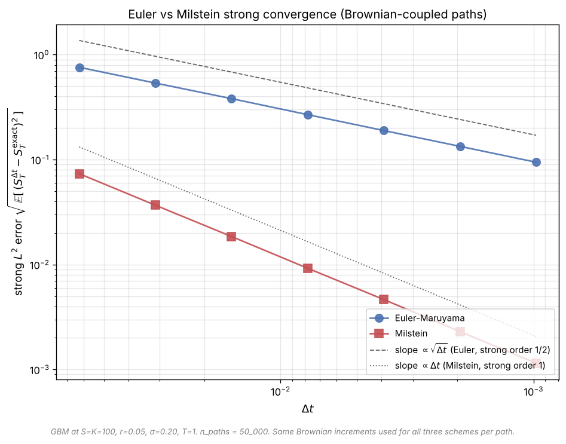

# Quantitative Finance Portfolio

Numerical methods for derivative pricing — closed-form formulas, Monte Carlo, finite differences and the Heston stochastic-volatility model — implemented in Python, ported to C++ and written up in 28 LaTeX notes. A self-directed continuation of my bachelor's thesis, built with AI coding assistants (see [How this project was made](#how-this-project-was-made)).


<p align="center">
  
</p>

<p align="center">
  <em>A European call under Heston priced four independent ways: Fourier inversion, Monte Carlo with Andersen's QE scheme, a 2D Douglas ADI PDE solver and full-truncation Euler Monte Carlo. Bottom panel: relative difference from the Fourier price, with 95% confidence intervals for Monte Carlo.</em>
</p>

## About this project

This repository grew out of my bachelor's thesis in Mathematics, [*From the Risk-Neutral Measure to Girsanov's Theorem in Stochastic Integration: Pricing of Financial Products*](https://github.com/indexxxxbraker/option-pricing-via-martingales) (University of Oviedo; defence expected May 2027), which develops the theory of European option pricing from the binomial model up to the Black-Scholes formula. The thesis ends where the numerical questions begin: how do you compute a price when there is no closed form, how do you know that a computed price is right, and what changes once volatility stops being constant.

This project is my attempt to work through those three questions. I built it in the spring of 2026, during my Erasmus year in Rome, while I was finishing the thesis and the theory was fresh. It is organised in four phases of increasing difficulty, and every phase follows the same loop: write up the theory in LaTeX, implement it in Python, check it against an independent method within a stated tolerance, then port it to C++ and test it again.

## Highlights

- **Heston priced four independent ways.** The PDE matches the Fourier price to within 0.1% for strikes 80–115 (0.3% at 120), and all eighteen Monte Carlo prices fall inside their 95% confidence intervals.
- **Variance reduction from a factor of 2 to a factor of 1,300.** Antithetic variates halve the variance of a European call; a geometric-Asian control variate cuts that of an arithmetic Asian call by about 1,300.
- **Solvers written from scratch** rather than imported: Cholesky, Thomas, projected SOR, Acklam's inverse normal CDF, Sobol sequences with Joe–Kuo direction numbers.
- **Convergence studies.** On the test problems, the observed error slopes for Euler–Maruyama and Milstein (1/2 and 1), Crank–Nicolson with Rannacher start-up and the Douglas ADI grid (2) agree with the orders given in the literature.
- **200 Catch2 test cases** on the C++ side, mirroring the Python validation scripts.

**Scope.** European, American and selected exotic options under Black-Scholes and Heston dynamics, with non-dividend-paying assets and a constant interest rate. Jump-diffusion and local-volatility models are out of scope.

## Project phases

### Phase 1 — European options under Black-Scholes

- Black-Scholes pricer derived by the martingale route, with the five closed-form Greeks checked three independent ways.
- Implied volatility by safeguarded Newton–Raphson with a Brent fallback.

Theory: 3 notes in [`theory/phase1/`](theory/phase1/).

### Phase 2 — Monte Carlo methods

- Exact GBM sampling; Euler–Maruyama and Milstein discretisations, with their strong convergence observed against exact paths.
- Variance reduction: antithetic variates, control variates and randomised quasi-Monte Carlo (Sobol and Halton).
- Monte Carlo Greeks: bumping with common random numbers, pathwise and likelihood-ratio estimators.
- Arithmetic Asian call with a geometric-Asian control variate: on the same path the two averages differ only at second order, so their correlation exceeds 0.999.
- American put by Longstaff–Schwartz regression.

Theory: 13 notes in [`theory/phase2/`](theory/phase2/).

### Phase 3 — Finite differences and lattices

- Explicit (FTCS), implicit (BTCS) and Crank–Nicolson schemes, with their stability analysed and their convergence observed on test problems.
- A Thomas solver for the tridiagonal systems and projected SOR for the American put.
- A trinomial lattice, shown to coincide with the explicit scheme up to where the discount factor is applied.
- A final benchmark cross-validating 16 pricers against Black-Scholes and a lattice reference.

Theory: 6 notes in [`theory/phase3/`](theory/phase3/).

### Phase 4 — The Heston model

- The variance process: Feller condition and conditional moments.
- Fourier pricing (Carr–Madan FFT and Lewis), Monte Carlo (full-truncation Euler and Andersen's QE scheme) and a 2D Douglas ADI PDE solver.
- Calibration to a synthetic implied-volatility surface by inverse-vega-weighted least squares.
- Exotics: Asian, lookback and barrier options by Monte Carlo; the American put by PDE with projection.

Theory: 6 notes in [`theory/phase4/`](theory/phase4/).

## Results

<p align="center">
  
</p>

*Variance reduction against the IID baseline. The geometric-Asian control variate is shown apart because it prices a different product. Sobol RQMC reaches a factor of about 60; it prices the 20-step Euler discretisation, whose small bias that factor does not count.*

<p align="center">
  
</p>

*Heston calibrated to a synthetic implied-volatility surface. Each panel shows market and model smiles at one maturity, with the RMSE.*

<p align="center">
  
</p>

*Strong convergence of Euler–Maruyama (slope 1/2) and Milstein (slope 1) for GBM, measured against exact paths driven by the same Brownian increments.*

More output is under [`python/results/`](python/results/): the ADI convergence study, the QMC-versus-IID comparison, the Heston exotic prices and the QE-versus-Euler bias study. Two notebooks in [`notebooks/`](notebooks/) walk through the Heston cross-validation and the variance-reduction comparison; GitHub shows them with their outputs, so nothing needs to be run.

## What I learned

- I trust a number when two methods that share no code agree on it. Checking Fourier against the PDE and against Monte Carlo is what convinced me the Heston prices were right.
- A correct price says nothing about how fast you get there. The American put by Crank–Nicolson and projected SOR matched the binomial price, yet its error falls only at first order in the time step, not at the second order the notes first claimed. Only measuring the rate showed that.
- Stability theory is not a formality. The explicit scheme blows up as soon as the CFL condition fails, and Crank–Nicolson, which never blows up, still lets the payoff kink oscillate at large time steps unless the first steps are implicit.
- The biggest variance reduction came from the product itself, not from a generic technique. The geometric Asian has a closed-form price and is almost perfectly correlated with the arithmetic one, so as a control variate it cut the variance by a factor of about 1,300; on the European call, antithetic variates and simple controls gave factors of 2 to 7.
- Asymptotic rates can be a long way off. Quasi-Monte Carlo in dimension 20 converged like N^-0.62, not N^-1, for every sample size I tried (up to 2^16).
- A review is never finished: going back over the project in October turned up errors I had missed in May.

## Limitations

- **Model scope.** Non-dividend-paying assets and a constant interest rate throughout; constant volatility under Black-Scholes. No jumps, no local volatility.
- **Calibration data.** The Heston calibrator is tested on a synthetic surface (Heston prices plus noise), not on market quotes.
- **QMC convergence rate.** Sobol RQMC converges like N^-0.62 rather than N^-1 in this 20-dimensional problem; the (log N)^d factor has not died out at N ≤ 2^16. The plot keeps the N^-1 reference line.
- **QE versus Euler.** The bias study uses a Feller-violating parameter set, the regime QE was designed for; with the canonical parameters the two schemes agree within Monte Carlo noise.
- **C++.** The port follows the Python code closely and was written with AI coding assistants; my own C++ is not yet at that level. It is single-threaded and not tuned for speed.
- **No CI.** The tests are run locally.

## How this project was made

I wanted to learn these methods by building them, and working with AI coding assistants (Anthropic's Claude) was the most effective way I found to do that on my own. The assistants drafted most of the code and most of the LaTeX from specifications I wrote: which method to implement, which references to follow, which checks it had to pass. I chose the topics, their order and the sources, checked every derivation, designed the validation (what each pricer is checked against, and how tightly), made the trade-offs along the way (which scheme, which parameters, what to drop) and did the debugging. Much of what I learned came from that loop: specifying a method, checking it against an independent one, and working out why the two disagreed when they did.

**October 2026 revision.** Five months later I went over the project again, with the same tools: every claim in the notes was checked against the code and its output, and I reviewed the corrections commit by commit. It turned up errors I had missed in May: a few bugs and silently failing checks in the code, and in the notes some numbers the code did not reproduce, convergence orders stated without being checked, a misprinted formula and wrong citations. All of them are fixed, each in its own commit with the reason in the message, and every number in the notes now has to come from a script in the repository. I will keep checking the notes, the code and this README against each other.

## Repository structure

```
quant-finance-portfolio/
├── cpp/                            C++ port of the library
│   ├── include/quant/              Public headers (25 modules, namespace quant::)
│   ├── src/                        Implementation files
│   ├── tests/                      Catch2 test suite
│   ├── data/                       Sobol direction numbers (Joe-Kuo)
│   └── CMakeLists.txt
├── python/                         Python reference implementations
│   ├── quantlib/                   Library modules (25, paired 1-to-1 with C++)
│   ├── validate_*.py               Per-module numerical validation scripts
│   ├── benchmark_phase{1..4}.py    Reproducible benchmark scripts
│   └── results/phase{1..4}/        Generated artifacts (PNG + CSV)
├── notebooks/                      Demo notebooks with rendered outputs
├── theory/                         LaTeX writeups (28 documents)
│   ├── phase1/                     European options under Black-Scholes
│   ├── phase2/                     Monte Carlo methods
│   ├── phase3/                     PDE finite differences and lattices
│   └── phase4/                     Heston stochastic volatility
├── requirements.txt
└── LICENSE
```

## Build and run

### Python

```bash
git clone https://github.com/indexxxxbraker/quant-finance-portfolio.git
cd quant-finance-portfolio
python -m venv .venv
source .venv/bin/activate
pip install -r requirements.txt

# Regenerate all phase artifacts (PNG + CSV under python/results/)
python python/benchmark_phase1.py
python python/benchmark_phase2.py
python python/benchmark_phase3.py
python python/benchmark_phase4.py
```

### C++

```bash
cd cpp
mkdir build && cd build
cmake ..
cmake --build . -j

# Run the Catch2 test suite
ctest --output-on-failure

# Or run the test binary directly
./quant_tests
```

## References

**Books**

- Etheridge, A. (2002). *A Course in Financial Calculus.* Cambridge University Press.
- Glasserman, P. (2004). *Monte Carlo Methods in Financial Engineering.* Springer.
- Hull, J. C. (2018). *Options, Futures, and Other Derivatives*, 10th ed. Pearson.
- Kloeden, P. E., & Platen, E. (1992). *Numerical Solution of Stochastic Differential Equations.* Springer.

**Papers**

- Heston, S. L. (1993). A closed-form solution for options with stochastic volatility. *Review of Financial Studies*, 6(2), 327–343.
- Carr, P., & Madan, D. (1999). Option valuation using the fast Fourier transform. *Journal of Computational Finance*, 2(4), 61–73.
- Lewis, A. (2001). A simple option formula for general jump-diffusion and other exponential Lévy processes. Working paper.
- Andersen, L. (2008). Simple and efficient simulation of the Heston stochastic volatility model. *Journal of Computational Finance*, 11(3), 1–42.
- Longstaff, F. A., & Schwartz, E. S. (2001). Valuing American options by simulation: a simple least-squares approach. *Review of Financial Studies*, 14(1), 113–147.
- Giles, M. B., & Carter, R. (2006). Convergence analysis of Crank-Nicolson and Rannacher time-marching. *Journal of Computational Finance*, 9(4), 89–112.
- Joe, S., & Kuo, F. Y. (2008). Constructing Sobol sequences with better two-dimensional projections. *SIAM Journal on Scientific Computing*, 30(5), 2635–2654.

## Author

**Roberto Cepeda Rocandio** — Mathematics & Physics undergraduate, University of Oviedo.

LinkedIn: [linkedin.com/in/robertocepedarocandio](https://www.linkedin.com/in/robertocepedarocandio)

## License

MIT — see [LICENSE](LICENSE).
